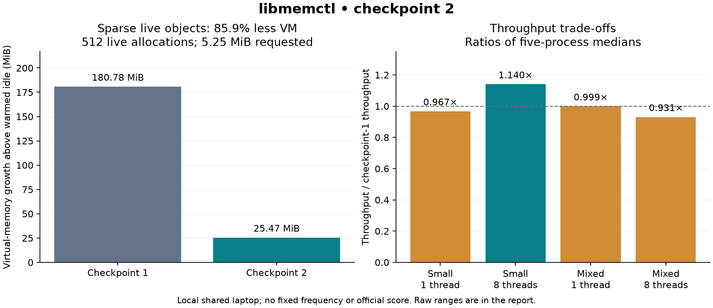

# Checkpoint 2 — adversarial validation and compact regions

Completed 9 November 2026. The exact allocator source is SHA-256
`cf94b9332b0ad6078b4f61611673135495b0c5d4205244c0fb60ebb468a396d0`.
The first checkpoint's results remain historical; this report describes the
current implementation. No official score or submission is claimed.

## Problem found and change made

The original region policy reserved at least 64 KiB and 32 blocks per size class.
A new adversarial trace keeps one allocation per class in each of eight shards:
512 live objects, 5,500,928 requested bytes. After warming the thread-stack cache,
the old allocator held **185,120 KiB** of VM above idle for that payload.

Regions now start at a 16 KiB minimum and four-block target. A bin that exhausts
a starter region remembers that demand and subsequently allocates 32-block
regions. An undersized starter region is allowed to drain rather than repeatedly
refilled. Fully empty undersized regions in busy bins are returned immediately.
The existing 2 MiB global empty-cache bound, large-mapping path and API remain.
Packed state/count fields and an aligned bin array limit metadata/cache costs.

Five-process medians: current held VM growth **26,080 KiB**, an **85.9% reduction**
on the sparse trace. Both versions return to their sampled idle VM after trim.
The current policy still has about 4.85× virtual-space growth per requested byte
on this deliberately sparse trace; it does not eliminate fragmentation.

## Performance trade-off

Same local laptop/compiler/flags, fixed trace, 500,000 measured calls per worker,
2,000 warmup calls, five fresh processes, randomized order, identical affinity per
comparison. Million API calls/s, medians:

| Workload | Threads | Checkpoint 1 | Current | Current / old |
| --- | ---: | ---: | ---: | ---: |
| Small | 1 | 42.549 | 41.165 | 0.967× |
| Small | 8 | 61.597 | 70.242 | 1.140× |
| Mixed | 1 | 32.040 | 32.000 | 0.999× |
| Mixed | 8 | 60.784 | 56.568 | 0.931× |

Eight-thread mixed min–max ranges are **53.401–64.862 M** for old and
**39.015–76.573 M** for current; the shared laptop has substantial variability.
The point estimates support a space/throughput trade-off, not a universal speed
win or a statistically established improvement. No comparison against libc or
official normalization is implied.



## Rejected experiments preserved

`results/checkpoint2-2026-11-09` is the first compact policy: 4/8/16/32-block growth
based only on current region count. It reduced sparse VM but lost roughly 77% of
eight-thread mixed throughput, so it was rejected.

`results/checkpoint2-learned-growth-2026-11-09` remembers demand but still refills
small starter regions. Its eight-thread mixed throughput was roughly 48% lower;
it was rejected. `results/checkpoint2-draining-growth-2026-11-09` adds draining and
records an intermediate layout. `results/checkpoint2-final-2026-11-09` records the
current packed/aligned layout. Every directory includes raw outputs, source and
binary hashes, exact commands and five-run summaries; no measurements were removed.

## Correctness actually executed

- Current candidate: all **six unchanged official public tests passed**.
- Independent edge/failure/reuse/cache tests: passed natively and under ASan/UBSan
  and TSan, including concurrent trim.
- Native full-pattern soak: three seeds, **3,000,000 mixed operations plus 786,432
  synchronized cross-thread ownership handoffs**, all passed.
- ASan/UBSan soak: **1,000,000 mixed operations plus 65,536 handoffs**, passed.
- TSan soak: **200,000 mixed operations plus 32,768 handoffs**, passed.
- GCC static analysis and forbidden-symbol checks passed. The symbol checker now
  also runs on Python 3.6 without changing the prohibited-symbol set.

The soak uses position-dependent byte patterns, class/large thresholds, calloc
zero checks, realloc-prefix checks and eight-thread barrier-synchronized ownership
transfers. It is an authored hidden-style test, not access to hidden official tests.
LeakSanitizer remains excluded; ASan sub-block-boundary coverage is still limited.

## Separate-machine validation

The current source built with **GCC 9.3.1** on the NHPC login host. The built
executables then ran in an allocated eight-CPU compute-node job, on Linux x86-64
with **glibc 2.17**. The source hash printed remotely matches the current source
above. Independent tests, **1,000,000 additional mixed operations plus 262,144
handoffs**, and the sparse-region integrity/trim probe all passed.

The [compute-node log](results/nhpc-checkpoint2/validation.txt) is the evidence.
This is not a claim that compilation happened on the compute node, that the
official runner was uploaded/run there, or that cluster performance was measured.
Only authored source/tests were transferred; official materials stayed local.

The first direct PBS job was system-held before test execution and was removed.
After the user explicitly approved the existing cross-account submission wrapper,
the first routed attempt failed because GCC 9's setup was absent on the compute
node. Building on the login host and executing in the allocation resolved that
environment mismatch. Project files remained in the requested roll directory;
the user approved the wrapper's normal staging area. No scheduler hold or access
control was bypassed, and no other student's files/job were modified.

## Reproduction

```bash
make check public-test
make soak fragmentation
./build/soak 125000 7654321 512
```

To replay policy comparisons, build the checkpoint-1 source in `build-checkpoint1`
using the same C flags, and current source in `build`, each with `benchmark` and
`fragmentation` targets. The initial source hash is recorded in each raw JSON.
Then:

```bash
python3 scripts/compare_regions.py --output results/new-policy-comparison
python3 scripts/plot_checkpoint2.py
```

No benchmark depends on input names/fingerprints. The allocation policy observes
size classes and their capacity pressure, not the benchmark identity.

Next milestone: debug sub-block annotations and stronger fragmentation/latency
evaluation, followed by final package/demo review. Remaining tasks include final
normalization/form/team details and any required recording. The development
repository is separate from official submission; no form has been submitted.
