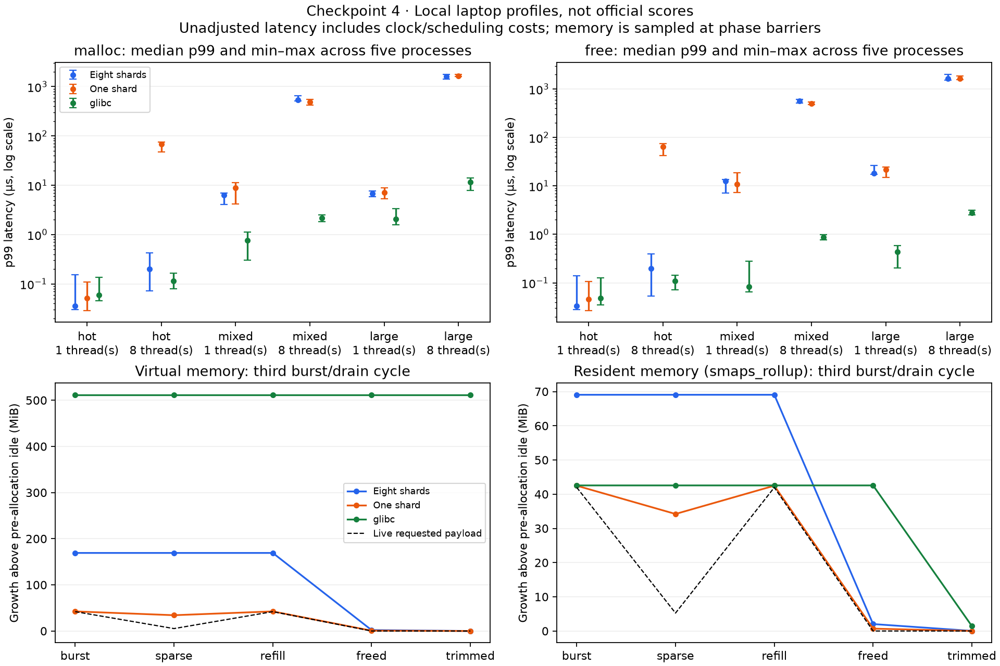

# Checkpoint 4 — latency tails and allocation lifetimes

Completed 9 November 2026. **Measurement milestone; allocator policy unchanged.**
Allocator SHA-256 remains
`521932e19106be195857014b44c2531e137c2b6e54cd33927f93cb138952e9a0`.
The new workloads identify limits to address; they are not an official score.

## What was measured

105 fresh processes: five repetitions of three allocators × three latency traces
× one/eight threads, plus five eight-worker space runs per allocator. Variants:
current eight shards, the same source with one shard, and host glibc 2.43 through
the identical authored harness. GCC 15.2.0, Linux x86-64, strict C11 warnings and
identical `-O2 -g` flags. Allocation builtins are disabled in the harness too.
No libc allocation call was added to the allocator implementation.

Latency traces use 128 slots per worker: `hot` repeatedly allocates/frees 33-byte
objects; `mixed` covers class boundaries from 1 to 131,072 bytes; `large` uses
65,537–131,072 bytes. Mixed/large include malloc, free, realloc and calloc. Every
worker warms for 2,000 calls, then resets its deterministic trace seed and records
10,000 calls. The workers start together; API distributions/counts are in raw data.
Payload endpoint/prefix verification and sample writes are outside timed calls.

Each call is bracketed by monotonic clock reads. Samples are pooled across workers
in a process and sorted per API; percentiles use nearest rank. CSV reports the
median of five process percentiles, with their min/max, **not** the percentile of
all processes pooled. Timer-pair median ranged 12–63 ns; nothing is subtracted.
Tiny hot-call differences near that overhead should not be overinterpreted.
Scheduling, instrumentation and the shared laptop affect the observed tails.

## Latency result

Median process p99 **malloc** latency, microseconds (lower is better):

| Trace | Threads | Eight shards | One shard | glibc |
| --- | ---: | ---: | ---: | ---: |
| Hot | 1 | 0.036 | 0.051 | 0.060 |
| Hot | 8 | 0.198 | 68.473 | 0.115 |
| Mixed | 1 | 6.384 | 8.905 | 0.767 |
| Mixed | 8 | 537.902 | 483.879 | 2.161 |
| Large | 1 | 6.826 | 7.051 | 2.062 |
| Large | 8 | 1,606.008 | 1,639.930 | 11.610 |

Hot eight-thread p99 ranges were 0.073–0.423 µs with eight shards versus
47.211–74.481 µs with one. The sharding strategy reduces the shared-bin contention
in this trace. It does not solve the large-allocation path: eight-shard large p99
ranged 1,436.632–1,783.286 µs. That path maps/unmaps dedicated objects repeatedly;
the measurements are consistent with VM-operation costs and scheduling under
concurrency, but are not a syscall-level causal profile. glibc has substantially
lower mixed/large tails here. No universal speed advantage over libc is claimed.

The CSV also includes free/realloc/calloc p50/p95/p99/p99.9/max and counts. Very
extreme percentiles with few tail samples are exploratory, not stable guarantees.

## Space result and the earlier baseline correction

Eight workers stay alive through every sampled phase. Before any worker allocation,
the baseline includes their stacks and warmed harness proc-file parsing. Each cycle:
allocate 4,096 fully touched objects across all 64 classes (44,007,424 bytes), drain
to 512 survivors (5,500,928 bytes), refill the holes with shifted size classes,
free everything, then trim. Three cycles expose behavior after prior heavy use.
Full byte patterns are checked before release and while survivors remain live.

At phase barriers, the harness reads VmSize/VmRSS/VmPeak/VmHWM and smaps_rollup RSS.
These are process counters, with an idle subtraction; allocator attribution still
contains runtime noise. Phase samples do not identify every transient peak.
Whole-process high-water counters are preserved separately in raw JSON. Smaps RSS
complements approximate VmRSS. All payload pages are touched, not merely reserved.

Third-cycle medians, **KiB above pre-allocation idle**:

| Phase | Eight-shard VM / RSS | One-shard VM / RSS | glibc VM / RSS |
| --- | ---: | ---: | ---: |
| Sparse survivors | 173,216 / 70,720 | 35,032 / 35,036 | 524,164 / 43,584 |
| After all frees | 2,048 / 2,080 | 704 / 708 | 524,164 / 43,584 |
| After trim | 0 / 32 | 0 / 4 | 524,164 / 1,472 |

RSS in this table is smaps_rollup. The extra 32/4 KiB after custom trim is consistent
with initialized bin metadata, not retained payload mappings. glibc retains large
virtual reservations while trim reduces its resident growth; VM and RSS describe
different costs. Its thread caches are not explicitly flushed.

The current policy retains **173,216 KiB of VM for 5,500,928 requested bytes** in
the third sparse phase, versus the earlier checkpoint-2 cold sparse trace's
26,080 KiB. Learned 32-block growth preserves throughput after demand, but isolated
survivors can pin those larger regions. The earlier 85.9% cold-trace reduction is
not a general fragmentation guarantee. Empty-cache retention remains bounded;
live partially occupied regions are a separate limitation.

An initial 105-process run warmed each worker allocator before idle. That hid
glibc's first-use arena reservation inside baseline and produced zero subsequent
VM growth. We rejected that space comparison, retained all raw evidence and
authored source snapshots in `results/checkpoint4-warm-baseline-2026-11-09`, then
reran all 105 profiles with the pre-allocation baseline above. Neither run was
silently removed or mixed into the accepted medians.



## Validation and reproduction

All 105 accepted profiles passed payload/schema/count/phase checks. Strict builds
and independent/public tests passed. Both new concurrent harnesses ran under
ASan/UBSan and TSan; the corrected lifetime harness was revalidated after the
baseline fix. Sanitizer timings/space counters are not used as benchmark results.
LeakSanitizer remains disabled for the previously recorded host limitation.
A clean archive of the staged standalone project also built both variants/libc
harnesses, passed independent checks and completed 21/21 fresh-process smoke
profiles without the official kit or parent workspace; see
[clean reproduction](results/checkpoint4-validation-2026-11-09/clean-reproduction.json).

```bash
make check profiles build/latency_libc build/lifetimes_libc
make BUILD_DIR=build-single CPPFLAGS='-D_GNU_SOURCE -Iinclude -DMEMCTL_SHARDS=1' check profiles
python3 scripts/profile_workloads.py --repetitions 5 --operations 10000 --output results/new-profile
# Plot the committed accepted data; optional matplotlib dependency only:
MPLCONFIGDIR=/tmp/libmemctl-matplotlib python3 scripts/plot_checkpoint4.py
```

Primary evidence: [raw profiles](results/checkpoint4-2026-11-09/raw.json),
[summary](results/checkpoint4-2026-11-09/summary.csv), and
[validation](results/checkpoint4-validation-2026-11-09/final.json).
Each run records commands, failures, output, source/binary hashes, affinity order,
compiler/CPU/libc and relevant glibc environment settings. Jobs run sequentially in
randomized order; each variant uses the same cpuset (physical cores first, then
SMT). Workers can migrate within it. No fixed clock/thermal/background isolation,
official normalization or NHPC timing is claimed. No dependency was installed.

## Next bounded milestone

Evaluate one bounded reuse policy for repeated large allocations, with cache caps
and correctness/latency/space regression checks. Keep the current implementation
unless the measured trade-off supports a replacement. Then finish compatible clean
Ubuntu/package/demo review. Burst survivor fragmentation remains a separate risk.
Final form/roster/normalization/recording checks and official submission are pending.

The user explicitly authorized regular reviewed development-checkpoint pushes to
the supplied GitHub main. This authorization does not submit the competition form.
