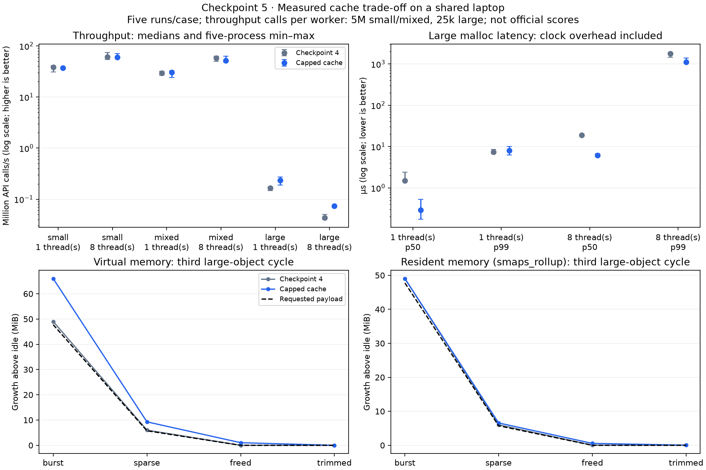

# Checkpoint 5 — capped large-object reuse

Completed 9 November 2026. **Adopted with an explicit throughput/space trade-off.**
Current allocator SHA-256:
`ce2e34f557608c4c1cd4277a12dc85fa88cdcc343e6540d74924ddd31024d267`.
The exact checkpoint-4 source is the comparison baseline; no official score is claimed.

## Change and invariants

Requests above 64 KiB through 1 MiB can reuse one dedicated mapping per shard and
64-KiB size band. Capacity is rounded to the band's upper bound before the existing
checked header addition/page rounding. Larger requests retain the uncached mapping
path. There are 15 bands per shard, each with a mutex and a single cached pointer.
A region-header union stores either a small-region free-list head or the immutable
large-cache owner; the target region/header sizes remain unchanged. The dedicated
region's `owner == NULL` discriminates those states.

Small empty regions and large cached mappings share the **same 2 MiB atomic byte
budget**, including mapping headers and page padding. A full bucket or exhausted
budget causes immediate unmapping. Taking a cached mapping removes its reservation
under that bucket's lock; returning it reserves bytes before publication. No path
holds two allocator locks. Cross-thread free returns to the static original bucket,
including after the allocating thread exits. TLS holds a shard number, not a cache
pointer. `memctl_trim()` visits both cache types, releasing only unused mappings.
Concurrent activity can refill a bucket after trim has visited it.

ASan builds poison cached large payloads/headers and expose exactly the new request
on reuse. Calloc explicitly zeroes requested bytes, including reused dirty mappings.
Mapping failure on a cache miss preserves the old realloc object; a cache hit can
legitimately succeed while new mappings are failing. Tests now distinguish those
cases. The existing small-region growth/reclamation policy is unchanged.

Large allocate/free paths are separate helpers with an optional GCC/Clang noinline
hint, keeping their added logic out of the small-call bodies. This is a code-layout
choice, not proof of its isolated performance effect. Define `MEMCTL_LARGE_CACHE=0`
to disable reuse for comparison; the normal independent tests also execute there.

## Measurements and decision

Final comparison: **140/140 fresh processes passed**, five repetitions per case:
60 latency runs, 60 throughput runs and 20 phase-memory runs. Identical eight-shard
baseline/candidate, GCC 15.2.0, strict C11/`-O2 -g`, fixed trace seed 12345 and
randomized run order. Host remains the shared i3-1315U/glibc 2.43 laptop.

The short common-workload timings were variable, so a separate **40/40-process
confirmation** used 5,000,000 API calls per worker for small/mixed throughput.
Large throughput uses 25,000 calls per worker; latency uses 10,000 measured calls
after 2,000 warmup calls. Throughput's large requests span 65,537–196,608 bytes;
latency's large requests span 65,537–131,072. Do not equate those two traces.

Five-process throughput medians, million API calls/s:

| Trace | Threads | Checkpoint 4 | Current | Current / old |
| --- | ---: | ---: | ---: | ---: |
| Small, longer confirmation | 1 | 38.277 | 37.293 | 0.974× |
| Small, longer confirmation | 8 | 60.753 | 59.870 | 0.985× |
| Mixed, longer confirmation | 1 | 29.486 | 30.650 | 1.039× |
| Mixed, longer confirmation | 8 | 57.639 | 51.240 | 0.889× |
| Large | 1 | 0.165 | 0.235 | 1.425× |
| Large | 8 | 0.0437 | 0.0740 | 1.696× |

Eight-thread large throughput ranges: old 40,907–50,018 versus current
70,521–74,862 calls/s. Eight-thread mixed ranges overlap: old 49.936–63.310 versus
current 48.473–63.044 M calls/s. The 11.1% mixed median loss is retained as a cost,
not dismissed or promoted into a universal regression estimate.

Large malloc latency medians of process percentiles, microseconds:

| Threads | Old p50 | Current p50 | Old p99 | Current p99 |
| --- | ---: | ---: | ---: | ---: |
| 1 | 1.502 | 0.288 | 7.415 | 8.034 |
| 8 | 19.086 | 6.145 | 1,784.819 | 1,105.217 |

Eight-thread p99 fell about 38.1% in this run; one-thread p99 increased about 8.3%.
Calls still miss the bounded cache and enter the kernel. There is no tail-latency
guarantee. Clock bracketing and scheduling remain included; quantiles are nearest
rank within a process, then medians across five processes, never pooled globally.

The added large-object lifetime trace touches 50,070,016 requested bytes in 512
objects, drains to 64 survivors/6,029,376 bytes, refills with shifted sizes, frees
everything and trims; three cycles with eight workers kept alive. Third-cycle
medians, **KiB above pre-allocation idle**, RSS from smaps_rollup:

| Phase | Old VM / RSS | Current VM / RSS |
| --- | ---: | ---: |
| Burst | 50,176 / 50,208 | 67,584 / 50,212 |
| Sparse survivors | 6,144 / 6,176 | 9,504 / 6,724 |
| All freed | 0 / 32 | 1,056 / 580 |
| Trimmed | 0 / 32 | 0 / 36 |

Band rounding increases held VM by 34.7% in the burst, while resident growth is
nearly unchanged because unused capacity is not all touched. Cache retention is
an additional post-free cost; trimming releases its mappings. Phase samples are
not exact transient peaks; process VmPeak/VmHWM are retained in raw output.

The original small/class lifetime trace still pins 173,216 KiB of VM in its third
sparse phase. This change does **not** solve that survivor fragmentation. It trades
some virtual-space fit and mixed-workload throughput for repeatable improvements
on the previously weak large-object path, within an unchanged empty-cache bound.
That is the reason for adopting it, subject to final compatibility/package review.



## Preserved experiments and limitations

`results/checkpoint5-inline-trial-2026-11-09` retains the initial 140-process trial,
its exact allocator source and runner. Large throughput improved, but common short
timings regressed substantially and p99 did not improve. The final helper-layout
trial and longer common confirmation are separate directories; nothing was removed
or silently blended. A runner snapshot also preserves the final trial before its
long-confirmation CLI option was added. Duration, code layout and laptop conditions
changed between runs, so no isolated causal claim about noinline is justified.

No frequency, thermal or background isolation; workers can migrate within the
same physical-core-first cpuset, with SMT at eight threads. No new libc comparison,
official normalization, hidden-test score or cluster timing is implied. Static
bucket partitioning can leave cached bytes in idle shards/bands until trim, bounded
by 2 MiB. The added bucket descriptors also have a small fixed metadata cost.

## Executed validation

- All six unchanged official tests and the expanded independent suite passed.
- Injected mapping failure verified real cache reuse, calloc zeroing, failed-realloc
  preservation, 1 MiB eligibility boundaries, mixed-size cache pressure, errno
  preservation and trimming with live allocations. Wrapped mapping-byte accounting
  confirmed the shared 2 MiB bound and zero allocator mappings after quiescent trim.
- **59/59 ASan controls passed:** 25 valid accesses and 34 detected invalid accesses,
  including cached large use-after-free/reuse boundaries at 65,537 bytes and 1 MiB.
- Final native soak: two seeds, **2,000,000 mixed operations + 262,144 ownership
  handoffs**. ASan/UBSan: **1,000,000 + 65,536**. TSan: **200,000 + 32,768**.
  Concurrent trim and cross-thread frees are exercised; all passed.
- The full-touch large lifetime harness passed under ASan/UBSan and TSan. Strict
  warnings, forbidden-symbol checks, disabled-cache build/checks and GCC static
  analysis passed. LeakSanitizer remains disabled for the recorded host limitation.

Commands, outputs and source hashes: [final validation](results/checkpoint5-validation-2026-11-09/final.json).
Measurements: [main comparison](results/checkpoint5-2026-11-09/raw.json),
[longer common confirmation](results/checkpoint5-common-confirmation-2026-11-09/raw.json).
A clean standalone archive passed native checks, all 59 ASan controls, current
and historical-baseline builds, and 28/28 reduced comparison profiles without
the official kit or parent workspace. The earlier authored baseline source was
provided explicitly to that offline copy; see
[clean reproduction](results/checkpoint5-validation-2026-11-09/clean-reproduction.json).
This is current-host reproduction, not an older Ubuntu/container certification.
NHPC evidence remains scoped to checkpoint 2; no remote job was run here.

## Reproduce

From the standalone Git checkout, obtain our earlier authored source from history:

```bash
make check public-test sanitize profiles benchmark
mkdir -p build-checkpoint4
git show ad2ae279664ea83473f3092767dd6c2ef2214ff3:src/allocator.c > build-checkpoint4/allocator.c
make BUILD_DIR=build-checkpoint4 ALLOCATOR_SRC=build-checkpoint4/allocator.c profiles benchmark
python3 scripts/compare_large_cache.py --repetitions 5 --output results/new-cache-comparison
python3 scripts/compare_large_cache.py --repetitions 5 --throughput-operations 5000000 --common-throughput-only --output results/new-common-confirmation
MPLCONFIGDIR=/tmp/libmemctl-matplotlib python3 scripts/plot_checkpoint5.py
```

Only `public-test` needs the separately obtained official kit. For the disabled
configuration: `make BUILD_DIR=build-no-large-cache CPPFLAGS='-D_GNU_SOURCE -Iinclude -DMEMCTL_LARGE_CACHE=0' check`.
The expanded cached-large annotation controls target the default enabled build.

Next bounded milestone: clean compatible Ubuntu/package/demo review, including
current-source compatibility verification. Final form/roster/normalization/video
requirements and official submission remain pending. Reviewed development pushes
are authorized; official submission still needs separate approval.
