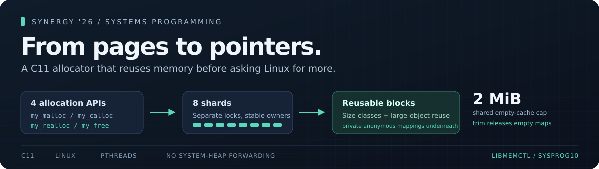

# libmemctl

**A thread-safe C11 memory allocator built on Linux mappings.**



Programs request bytes; Linux provides pages. **libmemctl bridges that gap** by
turning anonymous mappings into reusable, aligned blocks. It implements
`my_malloc`, `my_calloc`, `my_realloc` and `my_free` without forwarding to the system
heap, with checked size arithmetic and safe cross-thread ownership.

**Synergy '26 · Systems Programming · SYSPROG10**<br>
Jashandeep Singh · solo · IMT2024022

[Design](docs/architecture.md) · [Results & methodology](docs/report.md) ·
[PDF report](output/pdf/libmemctl-review.pdf) · [Demo video](demo/terminal-replay.mp4) ·
[Deliverables](docs/deliverables.md)

## Start here

| To… | Open or run |
| --- | --- |
| Understand the design | [Architecture and invariants](docs/architecture.md) |
| Check the implementation | [Allocator source](src/allocator.c) and [public interface](include/libmemctl.h) |
| Evaluate a fresh build | `python3 scripts/evaluate.py` — [rubric and review guide](docs/review-guide.md) |
| See the measured trade-off | [The results below](#measured-results) and [full report](docs/report.md) |
| Watch it working | [Actual terminal replay](demo/terminal-replay.mp4) or `bash demo/run_demo.sh` |

## Run it

On **Linux x86-64**, use a C11 compiler, Make, binutils, pthreads, coreutils and
Python 3.9+. No downloads or third-party Python packages are needed for these steps.

```bash
git clone https://github.com/Jdsb06/low-level-synergy26.git
cd low-level-synergy26
python3 scripts/evaluate.py
```

Already downloaded? Run the final command from the directory containing `Makefile`.
It verifies source/binary/media/document integrity, builds in a fresh directory,
checks forbidden symbols, runs the independent suite, and compiles/runs the example.
Exact commands, outputs and exit codes are saved in `build-evaluate-*/evaluation.json`.
For ASan/UBSan and all 59 annotation controls, add `--sanitizers`; the separately
obtained official suite can be added with `--official-dir '/path/to/SYSPROG10'`.

The [example](examples/basic.c) allocates zeroed storage, writes values, grows the
buffer while checking that those values survive, then frees and trims it:

```text
calloc: 8 zeroed items
realloc: 8 values preserved in a 32-item buffer
free + trim: example complete
```

For a precompiled test, run `prebuilt/bin/test_allocator`.
The [shipped library and executables](prebuilt/README.md) were tested on Linux
3.10/glibc 2.17 and Ubuntu 26.04.1/glibc 2.43; rebuild for another target.

## How it works

- **Reuse small blocks.** 64 size classes through 64 KiB share multi-block regions;
  compact starter regions grow after demonstrated demand.
- **Spread contention.** Eight shards and per-class locks protect metadata. Free
  follows the original owner even across threads and after the producer exits.
- **Bound empty retention.** Small caches and eligible large mappings share a
  **2 MiB cap**, including mapping overhead. Requests above 1 MiB are uncached.
- **Return unused memory.** `memctl_trim()` releases empty cached mappings while
  leaving live objects valid. No allocator path holds two locks at once.

The contract includes max alignment, distinct freeable zero-size allocations,
checked overflow, zeroed calloc storage and preservation of the old object when
realloc fails. [Read the design](docs/architecture.md) for layouts and invariants.

## Measured results

We measured bounded large-object reuse against our exact earlier implementation,
using identical traces on the same i3-1315U Linux laptop. **Five-process medians:**

| Measurement | Earlier implementation | Selected implementation | Change |
| --- | ---: | ---: | ---: |
| Large throughput, 8 threads | 43,663 calls/s | 74,036 calls/s | **+69.6%** |
| Large malloc p99, 8 threads | 1,784.819 µs | 1,105.217 µs | **−38.1%** |
| Large-burst virtual-memory growth | 50,176 KiB | 67,584 KiB | +34.7% |
| Mixed throughput, 8 threads, longer trace | 57.639 M calls/s | 51.240 M calls/s | −11.1% |

Large-object reuse improves that workload while consuming more virtual space and
lowering the mixed-workload median. Mixed-run ranges overlap; sparse live objects
can still pin regions. These are shared-laptop measurements, not an official score
or a universal speedup. [Full methodology, ranges and raw evidence](docs/report.md)
explain the decision; [reproduction commands](docs/reproduction.md) rerun it offline.

## Correctness before speed

**Executed validation:** six unchanged official tests, independent failure/overflow/
reuse/concurrency cases, **59 ASan controls** (25 valid, 34 detected errors),
ASan/UBSan and TSan stress, and GCC static analysis. GCC 9.3.1 and GCC 13.4 builds
have also executed successfully on the two Linux environments above.

```bash
python3 scripts/verify_submission.py  # Source, binary, media and document integrity
make sanitize                        # ASan/UBSan + expected-error controls
```

[Coverage and limitations](docs/report.md#validation-and-compatibility) include
LeakSanitizer being disabled, address-reuse detection limits and the supported
concurrency contract. Invalid/double frees, signal safety and fork-time lock repair
are outside the supported contract.

The [review guide](docs/review-guide.md#evidence-against-the-official-rubric) maps
correctness, throughput, space and engineering requirements to source and evidence.

<details>
<summary><strong>More: reproduction, deliverables and attribution</strong></summary>

- [Reproduction guide](docs/reproduction.md): official-suite path, stress, latency,
  memory profiles, exact comparison commands and deterministic packaging.
- [Deliverables](docs/deliverables.md): source, reports, testable output and demonstration.
- [Sources](docs/sources.md) and [participant / AI attribution](docs/author.md).
- [Results index](results/README.md): benchmark datasets, correctness and compatibility evidence.

| Directory | Purpose |
| --- | --- |
| [src/](src/) and [include/](include/) | Submitted allocator and its public API |
| [examples/](examples/) | A complete working API example |
| [tests/](tests/README.md) | Correctness, failure injection, sanitizer controls and stress |
| [bench/](bench/README.md) | Throughput, latency and memory measurement harnesses |
| [baselines/](baselines/README.md) | Pinned comparison implementation, built separately |
| [prebuilt/](prebuilt/README.md) | Verified Linux library and executable tests |
| [demo/](demo/README.md) | Recorded demonstration and live execution |
| [docs/](docs/README.md) | Design, report, evaluation guide and provenance |
| [scripts/](scripts/README.md) | Evaluation, reproduction and optional artifact tools |

`make` builds only `src/allocator.c`. The comparison baseline is used only by the
explicit reproduction commands. Official kit files are obtained separately; the
authored checks work offline.

</details>
