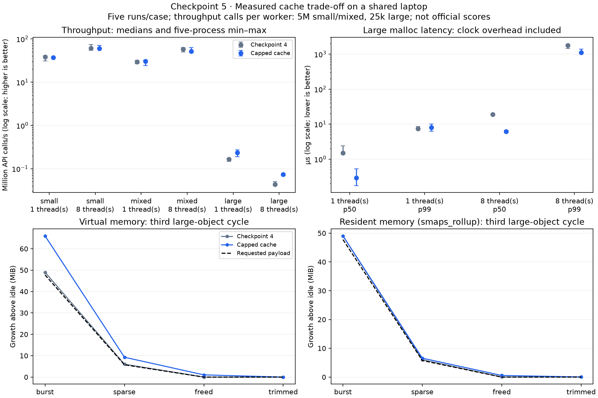

# libmemctl — design, validation and measured trade-offs

Jashandeep Singh · solo · IMT2024022 · SYSPROG10. Updated 10 November 2026.
Selected allocator SHA-256:
`ce2e34f557608c4c1cd4277a12dc85fa88cdcc343e6540d74924ddd31024d267`.

## Result and contract

The four required functions are implemented in C11 using private anonymous mmap
and pthread mutexes, without calls or forwarding to malloc, calloc, realloc or free.
All returned pointers satisfy `_Alignof(max_align_t)`. Zero-size allocations are
distinct and freeable; arithmetic overflow is rejected; failed realloc preserves
the old object. Reused calloc storage is explicitly cleared. Different objects can
be owned/freed by different threads, including after the allocating thread exits.
`memctl_trim()` is an optional reclamation extension.

All six unchanged public tests and our independent tests passed. This establishes
tested behavior, not a hidden-test result or a calculated official score. No final
normalization constants were provided in the reviewed statement.

## Design

Eight static shards contain 64 small size classes through 64 KiB. Class locks guard
region lists and free blocks; 16-byte block headers and 64-byte region metadata
support alignment and ownership. A compact initial region fits the larger of
16 KiB or four blocks; active bins grow to 32 blocks and drain undersized starters.
TLS stores only a shard number, so it does not leave dead thread-local caches.

Requests above 64 KiB use dedicated mappings. Through 1 MiB they are rounded into
64-KiB capacity bands, each with one reusable mapping per shard; larger requests
are uncached. Small empty regions and large cached mappings share one atomic
**2 MiB budget of actual mapping bytes**, including headers and page rounding.
If a slot/budget is unavailable, the mapping is unmapped. On a hit the reservation
is removed before reuse. No allocator path holds two locks simultaneously.

Free returns to the immutable original owner. Realloc grows/copies only after
successful allocation and preserves the requested prefix. Trim visits individual
locks and releases only empty mappings; concurrent activity may refill an already
visited bucket. ASan builds poison internal headers, excess capacity and freed
cached payloads, exposing exactly the requested bytes on reuse. Release layouts
and debug free-list handling are described in [ARCHITECTURE.md](architecture.md).

## Measurement method

The selected change is compared against the exact authored checkpoint-4 allocator,
SHA `521932e19106be195857014b44c2531e137c2b6e54cd33927f93cb138952e9a0`,
included in [baselines/](../baselines/README.md). Both use eight shards, GCC 15.2.0,
strict C11 `-O2 -g`, identical harnesses and pthreads on the same i3-1315U laptop
(six physical cores/eight logical CPUs, glibc 2.43). Runs are sequential fresh
processes in a fixed randomized order, with trace seed 12345. Workers can migrate
within the same physical-core-first CPU set; clocks, thermals and background work
are not controlled.

The main comparison has 140 processes: 60 throughput, 60 latency and 20 lifetime
runs. A separate 40-process confirmation lengthened small/mixed throughput to
5,000,000 API calls per worker. Large throughput uses 25,000 calls per worker and
65,537–196,608-byte requests. Latency uses 10,000 calls after 2,000 warmup calls,
with large requests 65,537–131,072 bytes. A realloc counts as one API call. Init,
warmup, thread creation and final cleanup are outside throughput timing; barriers
and endpoint checks are included. Separate tests check complete payloads.

## Throughput and latency

Million API calls/s; medians of five fresh processes:

| Workload | Workers | Previous | Selected | Change |
| --- | ---: | ---: | ---: | ---: |
| Small, longer confirmation | 1 | 38.277 | 37.293 | −2.6% |
| Small, longer confirmation | 8 | 60.753 | 59.870 | −1.5% |
| Mixed, longer confirmation | 1 | 29.486 | 30.650 | +3.9% |
| Mixed, longer confirmation | 8 | 57.639 | 51.240 | −11.1% |
| Large | 1 | 0.1647 | 0.2346 | +42.5% |
| Large | 8 | 0.0437 | 0.0740 | +69.6% |

Eight-thread large ranges are 40,907–50,018 versus 70,521–74,862 calls/s. Mixed
ranges overlap: 49.936–63.310 versus 48.473–63.044 million calls/s. The lower mixed
median remains a cost rather than a claim about every execution.

Large malloc latency, microseconds, medians of five process percentiles:

| Workers | Previous p50 | Selected p50 | Previous p99 | Selected p99 |
| --- | ---: | ---: | ---: | ---: |
| 1 | 1.502 | 0.288 | 7.415 | 8.034 |
| 8 | 19.086 | 6.145 | 1,784.819 | 1,105.217 |

Eight-thread p99 fell 38.1%; one-thread p99 increased 8.3%. Percentiles are nearest
rank within each process, pooling its workers, then medians across processes.
Clock bracketing and scheduling remain included. Cache misses still enter the
kernel, so this is no tail-latency guarantee or universal advantage over libc.

## Space and adoption decision

The full-touch large lifetime trace holds 512 objects/50,070,016 requested bytes,
drains to 64 survivors/6,029,376 bytes, refills with shifted sizes, frees and trims.
Eight workers remain alive for three cycles. Third-cycle medians, KiB above
pre-allocation idle (VM / RSS):

| Phase | Previous | Selected |
| --- | ---: | ---: |
| Burst | 50,176 / 50,208 | 67,584 / 50,212 |
| Sparse survivors | 6,144 / 6,176 | 9,504 / 6,724 |
| All freed | 0 / 32 | 1,056 / 580 |
| Trimmed | 0 / 32 | 0 / 36 |

Band rounding costs 34.7% additional held VM in the burst. RSS is almost unchanged
because slack is not fully touched. Phase samples are not exact transient peaks;
raw output also retains process VmPeak/VmHWM. The small/class trace still pins
173,216 KiB of VM in its third sparse phase: large reuse does not fix small-object
survivor fragmentation. Reuse is adopted for the repeatable improvement in a weak
large path, accepting these space/mixed-throughput costs within the empty-cache cap.

## Additional current-source scaling check — 10 November

The selected allocator was also executed at **1, 2, 4 and 8 threads**, with five
fresh processes per cell. Small/mixed traces use 5,000,000 API calls per worker;
large uses 25,000. All60 timing processes and10 separate space samples exited0.
These are a new current-source check, not replacements for the earlier paired
comparison. GCC15.2.0, strict C11 `-O2 -g`, fixed seed12345, randomized order and
physical-core-first shared CPU sets were recorded by the existing runner.

| Threads | Small, M calls/s | Mixed, M calls/s | Large, calls/s |
| --- | ---: | ---: | ---: |
| 1 | 39.987 | 31.041 | 228,226 |
| 2 | 38.885 | 29.406 | 310,597 |
| 4 | 38.081 | 32.287 | 264,940 |
| 8 | 59.201 | 51.383 | 233,274 |

The scaling is workload-dependent and not linear: the large path's kernel mapping
work and contention still limit it. Shared-desktop timing noise and overlapping
ranges are retained; this is not an official-machine score or a new causal claim
about sharding. Raw invocations, source/binary hashes, machine details, all runs and
ranges: [small/mixed](../results/current-scaling-common-2026-11-10/raw.json) and
[large](../results/current-scaling-large-2026-11-10/raw.json). Reproduction commands
are in [the guide](reproduction.md#current-source-thread-scaling).

## Validation and compatibility

- Six unchanged official public tests; expanded independent overflow, alignment,
  zero-size, size-boundary, injected mapping-failure, errno, calloc-reuse,
  failed-realloc and concurrency cases passed.
- Wrapped mapping accounting verified the shared 2 MiB cap, trim with live objects,
  real cache hits and zero allocator mappings after quiescent trim.
- All **59 ASan controls** passed: 25 valid accesses and 34 intentionally invalid
  accesses detected, covering small and cached-large suballocation boundaries.
- Native soak: 2,000,000 mixed operations and 262,144 ownership transfers;
  ASan/UBSan: 1,000,000/65,536; TSan: 200,000/32,768. All passed. Concurrent trim,
  post-producer-exit free, strict warnings, forbidden-symbol negative control,
  disabled-cache checks and GCC static analysis also passed.
- The same allocator source built with GCC 9.3.1 and ran on allocated NHPC
  Linux 3.10/glibc 2.17, passing independent checks, one million operations,
  131,072 transfers and the full-touch probe. GCC 13.4 on native Ubuntu 26.04.1
  passed public/independent/sanitizer checks. The shipped GCC9 binaries also ran
  on that Ubuntu host. This is execution evidence, not remote performance data.

RSS uses smaps_rollup where available and a checked smaps sum on the older kernel.
LeakSanitizer is disabled for the recorded host limitation. Sanitizers and static
analysis do not prove bug absence; address reuse and already unmapped storage
limit misuse detection. Invalid pointers/double frees and unsynchronized access to
the same object are outside the contract. There is no signal-safety/fork-repair
claim or support promise beyond the tested Linux x86-64 target.

## Reproduction and provenance

Use the build and exact offline comparison commands in [the reproduction guide](reproduction.md).
Full commands, environment, seeds, hashes, stdout/stderr and failures are preserved:

- [Main 140-process comparison](../results/checkpoint5-2026-11-09/raw.json) and
  [summary](../results/checkpoint5-2026-11-09/summary.csv).
- [Longer common confirmation](../results/checkpoint5-common-confirmation-2026-11-09/raw.json).
- [Native/sanitizer/static validation](../results/checkpoint5-validation-2026-11-09/final.json).
- [Current-source compatibility evidence](history/checkpoint-6.md).
- [Rejected initial trial](../results/checkpoint5-inline-trial-2026-11-09/raw.json) and
  [earlier experiment history](history/initial-report.md), kept separate from selected results.

The statement and API provenance are pinned in [SOURCES.md](sources.md); official
attachments are not redistributed. AI assistance and the participant-reported
permission are disclosed in [AUTHOR.md](author.md). No official score, private-test
result, organizer endorsement or submission receipt is claimed.
